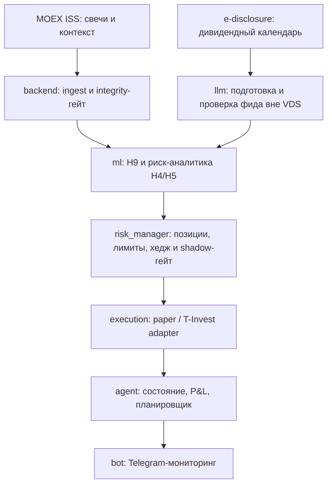

# MOEX Candle Predictor

Исследовательский проект по алгоритмической торговле на Московской бирже: от прогноза часовых
свечей до событийной стратегии с общим риск-слоем и автономным paper-исполнением.
Python, JSON Schema, SQLite, Docker Compose, T-Invest, Telegram.

**Проект завершён.** По решению автора эксплуатация сервера остановлена в середине октября 2026 года:
практически значимой прибыли проект не принёс. Устойчивая доходность на новых данных не подтверждена.
Репозиторий сохранён как законченная исследовательская и инженерная работа.

Итоги оформлены 9 ноября 2026 года. Финальная ветка — `main`, основная разработка велась в `demo`.
[Подробный разбор результатов и ограничений](docs/PROJECT_RETROSPECTIVE.md).

## Что сделано

- Сбор свечей, рыночного контекста и дивидендных событий; контроль целостности и торговый календарь.
- Исследования классификаторов, LSTM, Transformer, представления свечей как языка, кросс-секционных,
  макроэкономических и парных стратегий, новостных признаков и дивидендного эффекта.
- Риск-аналитика: EWMA-волатильность, режимный гейт Mahalanobis, лимиты, секторное хеджирование
  и распределение риска между стратегиями.
- Событийная стратегия H9: вход за 12 торговых дней до даты реестра, выход за 2 дня до неё,
  inverse-vol сайзинг и секторный хедж; отдельный допуск к реальному капиталу.
- Оркестратор EOD/pre-open с SQLite-состоянием, восстановлением после перезапуска, защитой от
  повторных ордеров, kill-switch, P&L-атрибуцией и Telegram-мониторингом.
- Развёртывание на Linux VDS через Docker Compose либо systemd.

## Результаты

| Направление | Итог |
|---|---|
| Прогноз направления часовой свечи (V1) | Валидационные результаты не перенеслись в deployment-симуляцию; направление закрыто |
| Цена, sentiment, макро-тилт, пары (H1/H2/H3/H6/H7) | Устойчивый результат после издержек не подтверждён |
| Волатильность и режимы (H4/H5) | Полезные компоненты риск-управления; самостоятельную доходность не доказывают |
| Дивидендная стратегия (H9) | Исторические тесты положительные; forward-гейт не пройден |
| Событийные новости (H8) | Незавершённая исследовательская ветка `research`; в итоговый торговый контур не включена |

Последний сохранённый [отчёт H9](data/reports/h9_shadow_pnl.txt) использует ценовую панель по
**25 августа 2026 года**: `n=19`, средний net **−1,77% на событие** относительно IMOEX с учтённой
комиссией, доля положительных событий **53%**. Гейт требует `n≥25`, `net>0`, `%pos>50%` и имеет
вердикт **NOT MET**; `is_production=false`. Это статистика событий, а не доходность счёта.

Для июльского paper/sandbox round trip в описании последнего коммита разработки зафиксирована
реконструкция **+540 ₽**: дивидендные позиции **−128 742 ₽**, секторный хедж **+129 282 ₽**.
Положительная сумма не подтвердила доходность самой дивидендной идеи. Полной сверенной выписки
за весь срок эксплуатации до октября в репозитории нет.

## Архитектура финального контура



Взаимодействие блоков проверяется JSON-схемами в [`contracts/`](contracts/README.md).
V3 проектировалась под несколько стратегий; фактический paper-контур работал с H9 и риск-слоем.
Свечи собирались на VDS. Дивидендный фид обновлялся **вне VDS** и доставлялся готовым CSV:
браузерный сбор e-disclosure не помещался в ресурсы сервера. Старые планы полной автономности
описывают целевую, а не полностью достигнутую конфигурацию.

## Локальная проверка

Для развёртывания использовался **Python 3.12** (`requirements.txt`); существующее Windows-окружение
проекта — `ml/.venv-win` (Python 3.14). Окружения и сырые Parquet-данные в Git не входят.
На новом Linux-окружении:

```bash
python3.12 -m venv .venv
.venv/bin/python -m pip install -r requirements.txt -r ml/requirements.txt pytest
.venv/bin/python scripts/validate_contracts.py
.venv/bin/python -m pytest ml/test_smoke.py agent/tests execution/tests backend/tests risk_manager/tests bot/tests llm/test_dividend_calendar.py llm/test_dividend_refresh.py llm/test_news_features.py -q
```

На существующем Windows-окружении:

```powershell
& "ml/.venv-win/Scripts/python.exe" scripts/validate_contracts.py
& "ml/.venv-win/Scripts/python.exe" -m pytest ml/test_smoke.py agent/tests execution/tests backend/tests risk_manager/tests bot/tests llm/test_dividend_calendar.py llm/test_dividend_refresh.py llm/test_news_features.py -q
```

Результаты проверок при завершении приведены в [итоговом отчёте](docs/PROJECT_RETROSPECTIVE.md).
Сетевая проверка T-Invest требует отдельных credentials и по умолчанию пропускается. Старые
нейросетевые исследования могут требовать [`ml/requirements_research.txt`](ml/requirements_research.txt).

Ручной демонстрационный цикл: `python -m agent.src.cli run-eod --force`. По умолчанию используются
mock-данные и paper-исполнение, создаётся локальное состояние в `data/agent/`.
Это демонстрация работы программы, а не проверка прибыльности.

## Документация

- [Итоги, этапы работы, результаты и ограничения](docs/PROJECT_RETROSPECTIVE.md).
- [Леджер гипотез](docs/RESEARCH_HYPOTHESES.md) и [целевая архитектура V3](docs/ARCHITECTURE_V3.md).
- [Источники и ограничения данных](docs/DATA_SOURCES.md).
- [История ML-исследований](ml/docs/research/README.md).
- [Оркестратор](agent/README.md), [риск-менеджер](risk_manager/README.md),
  [исполнение](execution/README.md), [мониторинг](bot/README.md).
- [Архивная инструкция развёртывания](infra/README.md) и [перенос forward-снимков](docs/FORWARD_SNAPSHOT_RUNBOOK.md).

Исторические отчёты и описания процесса работы сохранены со своими датами. Упоминания активных
работ или работающего сервера в них относятся к соответствующему этапу. Статус завершения проекта
имеет приоритет; положительные исторические тесты не заменяют проверку на новых данных.
